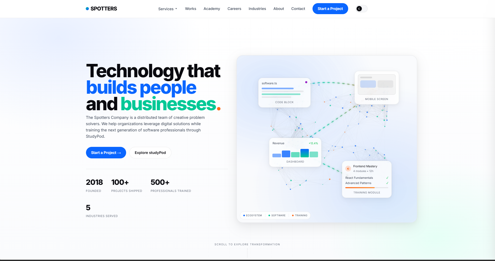

# The Spotters Company Website

The official website for The Spotters Company, a technology company providing digital strategy, software development, and training services.

**[Visit the live website](https://okeyodev.github.io/sppoters-website.1.0/)**

## Preview



## About the project

This is a responsive, multi-page website built with HTML, CSS, and vanilla JavaScript. It introduces Spotters' services, showcases selected work, and provides information about the company and its training programs.

### Features

- Responsive layouts for desktop, tablet, and mobile
- Light and dark themes, with the selected theme saved in the browser
- Mobile navigation drawer and nested service menus
- Scroll-triggered reveal effects and page-specific animations
- Dedicated pages for services, industries, company information, careers, and work

## Pages

- Home
- About
- Digital Strategy
- App Development
- Web Development
- ERP Solution
- Software Training
- Internship Program
- Industries
- Careers
- Works

## Run locally

The site is static and does not require a package installation or build step.

1. Clone or download this repository.
2. Open a terminal in the project folder.
3. Start a local web server:

   ```bash
   python -m http.server 8000
   ```

4. Visit [http://localhost:8000](http://localhost:8000) in your browser.

You can also use the VS Code Live Server extension. Serving the project over HTTP is recommended so that pages and assets load with the expected relative paths.

## Project structure

```text
.
├── index.html             # Homepage
├── pages/                 # Additional website pages
├── css/
│   ├── variables.css      # Shared design tokens and theme colors
│   ├── global.css         # Shared layout, navigation, and components
│   └── ...                # Page-specific styles
├── js/
│   ├── main.js            # Shared navigation, theme, and interactions
│   └── ...                # Page-specific interactions
├── images/                # Website images
└── Screenshot.png         # README preview image
```

## Technologies

- HTML5
- CSS3
- Vanilla JavaScript (ES6)

## Contact

For inquiries, visit [The Spotters Company website](https://okeyodev.github.io/sppoters-website.1.0/).
